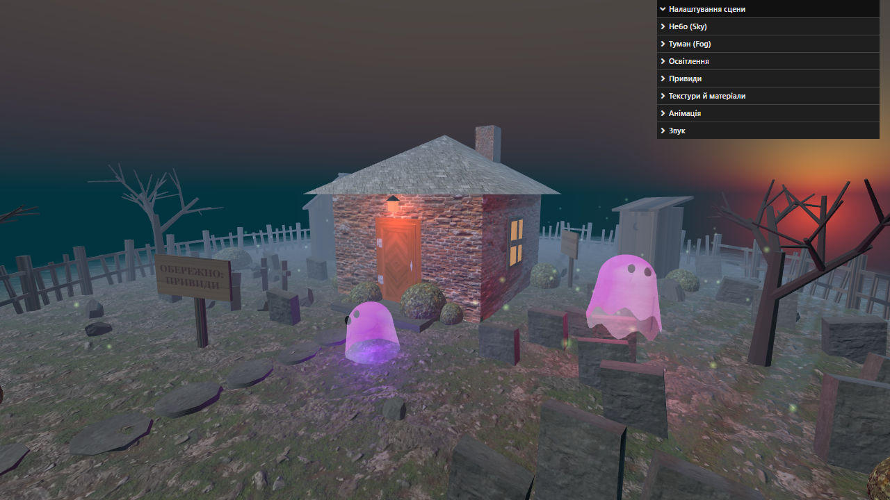
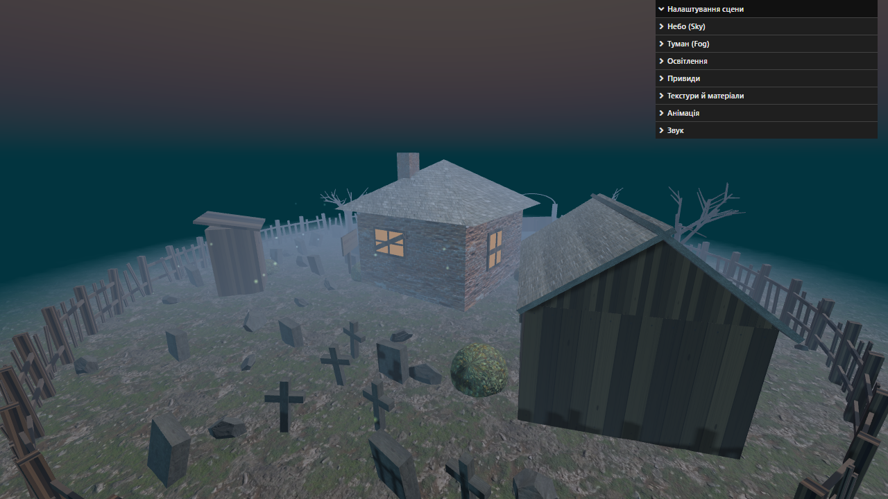

# Покинута садиба — фінальний проєкт №1

Дисципліна: «Відтворення 3D елементів та просторів у веб-середовищі з використанням THREE.JS та R3F».

Проєкт побудовано на основі уроку «Міні проєкт» (Haunted House) і суттєво розширено:
замість одного «кубичного» будинку — ціла садиба з сараєм, вбиральнею, цвинтарем,
круглим парканом із хвірткою, кам'яною доріжкою, сухими деревами, табличками,
світлячками, блискавками та звуками.




## Запуск

```bash
npm install     # лише перший раз
npm run dev     # локальний сервер (відкриється браузер)
npm run build   # production-збірка у dist/
```

Після завантаження текстур натисніть «Увійти зі звуком» (браузер дозволяє звук лише після кліку)
або «Без звуку». Праворуч є панель lil-gui з усіма налаштуваннями.

## Обов'язкові вимоги

| Вимога | Як реалізовано (`src/script.js`) |
| --- | --- |
| Створення геометрії | Box, Cone, Plane, Sphere, Cylinder, Dodecahedron, Torus; власні геометрії: `ShapeGeometry` (фронтони сараю), `LatheGeometry` з хвилястим краєм (привиди), рекурсивні дерева, злиті через `mergeGeometries`; `InstancedMesh` для паркану, могил, хрестів, каміння й доріжки |
| Імпорт текстур | `TextureLoader` + `LoadingManager` (прогрес на заставці); текстури Poly Haven у форматі **WEBP**: земля (з картою зміщення), цегла, черепиця, листя, камінь, двері (7 карт) |
| Створення матеріалів | `MeshStandardMaterial` з map / aoMap / roughnessMap / metalnessMap / normalMap / displacementMap / alphaMap; емісивні матеріали вікон і ліхтаря; `PointsMaterial` для світлячків; процедурні `CanvasTexture` — дерев'яні дошки, таблички з написами, двері вбиральні з півмісяцем |
| Освітлення | `AmbientLight`, `DirectionalLight` (місяць, з тінями), `PointLight` біля дверей (миготить), 3 `PointLight`-привиди з тінями, окреме світло для блискавок |
| Анімація | Привиди літають орбітами, ниряють під землю й повертаються обличчям у напрямку руху; миготіння ліхтаря; «свічки» у вікнах; рипучі двері сараю; світлячки; блискавки |
| Небо | `Sky` з `three/addons/objects/Sky.js`, параметри turbidity / rayleigh / mieCoefficient / mieDirectionalG / elevation / azimuth у GUI, як у прикладі three.js |
| Туман | Перемикач `FogExp2` / `Fog` / без туману, колір, щільність, near/far; під час блискавки туман підсвічується |

## Додатково (з переліку ідей уроку)

- **Більше повзунків:** кольори та інтенсивність усіх світел, позиція місяця, швидкість/радіус/яскравість/колір привидів, повтори текстур (земля, цегла, дах, камінь), рельєф землі, кольори кущів, дерев і світлячків.
- **Налаштування Sky** як у прикладі `webgl_shaders_sky`.
- **Не лише кубичний будинок:** сарай із двосхилим дахом і дверима на завісі, вбиральня на задньому дворі, димар, ганок, вікна з рамами, ґратами й забитими дошками.
- **Більше об'єктів:** круглий паркан зі зламаними штахетинами, кована арка хвіртки, кам'яна доріжка, каміння, хрести, сухі дерева, дерев'яні таблички, більше кущів.
- **Звуки** (Web Audio API, без аудіофайлів): вітер (відфільтрований коричневий шум), позиційний «стогін» кожного привида через `PositionalAudio` (чим ближче привид — тим гучніше), грім після блискавки. Гучність регулюється в GUI.
- **Миготіння світла біля дверей** з регульованою силою.
- **Оптимізація:** WEBP замість JPG, `InstancedMesh`, злиття геометрій дерев, тіні привидів можна вимкнути.

Для швидкого перегляду без заставки можна відкрити `index.html#nointro`.
